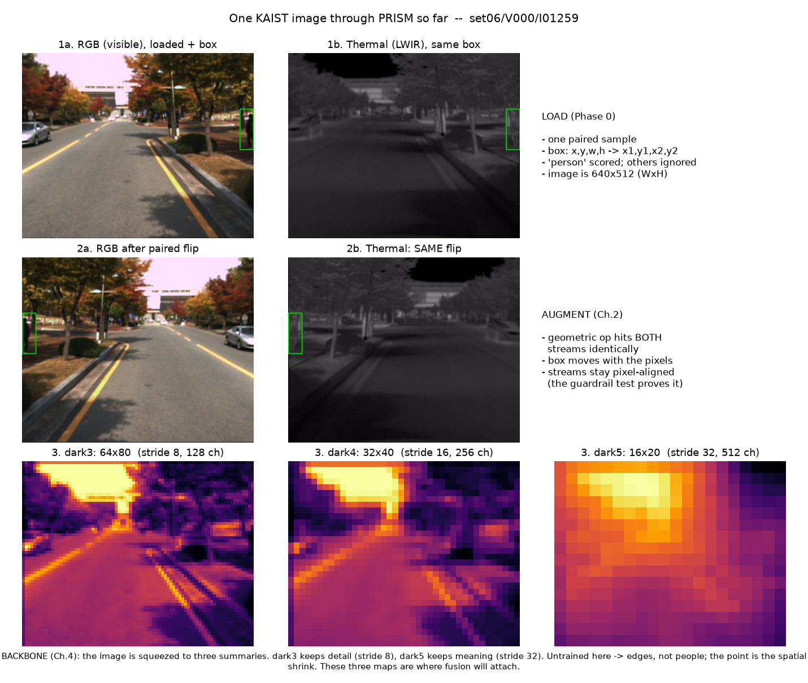

# Pipeline Trace — one real image through PRISM

The living visual record: we follow **one real KAIST frame** (`set06/V000/I01259`, a daytime
tree-lined avenue with a single pedestrian) through every step we've built, and watch what
happens to it. Regenerate any time with `python scripts/trace_image.py`. This file grows as the
pipeline grows — a new panel is added each phase.

*(Figure snapshot committed at `docs/figures/pipeline_trace_phase1.png`; the backbone is seeded
so the feature maps are reproducible.)*

## What each row shows

### Row 1 — LOAD (Phase 0)
The frame arrives as a **pair**: the visible RGB image (1a) and the thermal LWIR image (1b),
looking at the same scene. The green box is the one scored pedestrian, drawn from the sanitized
annotation. Note the box sits at the **same pixel coordinates in both** — that shared alignment
is what fusion depends on.
- Box coordinates were converted `x,y,w,h → x1,y1,x2,y2` by the loader.
- `person` is scored; `people`/`cyclist`/`person?` are ignore regions (none here).
- The frame is 640×512.

### Row 2 — AUGMENT (Ch.2)
The same pair after a **paired horizontal flip**. The pedestrian, the road markings, everything
moves to the opposite side — **identically in both streams** (2a and 2b), and the box moves with
the pixels. This is the augmentation rule made visible: geometric ops hit both modalities the
same way, so the pair never comes unstuck. Our guardrail unit test is the automatic proof of
exactly this property.

### Row 3 — BACKBONE (Ch.4)
The RGB image squeezed into its three feature-map summaries, shown as heatmaps (bright = strong
activation):
- **dark3** — 64×80, stride 8, 128 channels. Still detailed: you can see the road edges, trees,
  and lane lines.
- **dark4** — 32×40, stride 16, 256 channels. Coarser; fine detail is gone, broad structure
  remains.
- **dark5** — 16×20, stride 32, 512 channels. Very coarse — just "bright region up here, road
  down there." It knows roughly *what* is *where*, not precisely where.

Two honest caveats, because they matter:
1. **The backbone is untrained here** (random weights). So these maps highlight edges and
   texture, not pedestrians. After training they will fire on people. The point of Row 3 right
   now is not *what* the maps detect but *the spatial shrink* — watch 64×80 → 32×40 → 16×20.
2. **This shrink is the misalignment story.** An 8-pixel offset between RGB and thermal is a full
   cell at dark3 (stride 8) but a quarter-cell at dark5 (stride 32). That's why *where* we fuse
   changes how tolerant the model is to the two cameras not lining up — the whole Phase-4
   headline, visible right here in the coarsening.

**These three maps are where fusion attaches.** When we go two-stream, a second backbone produces
a second set of dark3/dark4/dark5 from the thermal image, and the fusion operator merges the two.

## What gets added next
- **Neck (PAFPN):** a row showing the three maps *after* they exchange information across scales.
- **Head:** the raw box/score predictions before and after NMS.
- **Two-stream + fusion:** RGB maps, thermal maps, and the fused result side by side.
- **After training:** the same frame's feature maps once the model has learned — the moment the
  heatmaps start lighting up on the actual pedestrian.
